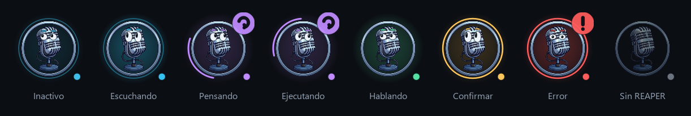

# Miky


[Español](README.md) · **English**

**A voice assistant for REAPER.** A floating microphone on your screen: you talk
to it and it drives the session. It listens and speaks on your machine; only the
language interpretation travels to the cloud.



Miky is not a REAPER plugin, not an application window, and it touches nothing
outside REAPER: it is an icon you drag around the screen plus an engine that runs
a closed catalog of commands against the DAW's API.

---

## What it does today (beta 0.1)

- **Always listening** (wake word “Miky”) or only when you click the icon.
- **Speaks Argentine Spanish** with a male voice (Tomás), or the built-in Windows
  voice when offline.
- **Understands** Rioplatense Spanish requests and turns them into actions.
- **Controls REAPER** from the inside: tracks, plugins, sends, item editing,
  transport, markers, tempo and rendering.
- **Finds plugins by description** (“an SSL-bus-style compressor”) and, when
  several match, offers numbered options.
- **Asks before breaking anything**: deleting tracks, rendering or overwriting.
- **Stops talking if you interrupt**: speak over it and it listens right away.
- **Asks “are you ready?” before recording** and starts silently, so its voice
  never ends up in the take.
- **Keeps working offline** for basic orders (local router).
- **Gives recording and mixing advice** when asked (without touching anything).

Things you can ask (real examples):

> “Miky, create a guitar track and load ReaEQ on it”
> “Miky, bring the bass up two dB”
> “Miky, record”
> “Miky, set the tempo to 96 and turn the metronome on”
> “Miky, render the mix”

The full catalog (55 commands in this beta) lives in
[`docs/03-catalogo-comandos.md`](docs/03-catalogo-comandos.md) (Spanish).

## How it works

```
  you speak
      │
      ▼
  [ microphone ]──VAD──►[ local text ]──wake word──►┌───────────────┐
                                                    │ local router  │──► direct command
                                                    └───────┬───────┘
                                                            │ (no match)
                                                            ▼
                                                  ┌───────────────────┐
                                                  │ cloud AI          │  Gemini by default
                                                  │ (picks commands)  │  (swappable provider)
                                                  └────────┬──────────┘
                                                           ▼
                                                  ┌───────────────────┐
                                                  │ engine + validator│  closed catalog
                                                  └────────┬──────────┘
                                                           ▼
                                             %APPDATA%\Miky\ipc  (files)
                                                           ▼
                                                  ┌───────────────────┐
                                                  │ ReaScript bridge  │  inside REAPER
                                                  └────────┬──────────┘
                                                           ▼
                                                        REAPER
                                                           │
                                                           ▼
                                                  spoken answer
```

All audio is processed locally (faster-whisper to understand, SAPI/edge-tts to
speak). The cloud only receives the order text and the project state — never
audio.

## Getting started

Requirements: Windows 10/11, REAPER 7, Python 3.11+.

```powershell
# 1. environment
python -m venv .venv
.\.venv\Scripts\python.exe -m pip install -e ".[voice]"

# 2. bridge inside REAPER (once)
.\.venv\Scripts\python.exe tools\build_lua.py
.\.venv\Scripts\python.exe -m miky install-bridge

# 3. check everything
.\.venv\Scripts\python.exe -m miky doctor

# 4. start the assistant
run_miky.bat
```

The first time you need a Gemini API key: right-click the icon → **Settings**.
You can get one for free at <https://aistudio.google.com/apikey>; it is stored
encrypted with your Windows user.

Then open REAPER (the icon menu has “Open REAPER with Miky”) and say **“Miky…”**.

Detailed guide (Spanish): [`docs/05-instalacion-uso.md`](docs/05-instalacion-uso.md).

### Executable (work in progress)

It can be packaged with PyInstaller:

```powershell
.venv\Scripts\python.exe -m pip install pyinstaller
.venv\Scripts\python.exe tools\build_exe.py
```

It produces `dist/Miky/Miky.exe` (no console). This is not yet the official
install path: bundling Qt + Whisper + onnxruntime is slow and still being
tested. For now, `instalar.bat` remains the recommended way.

## Console commands

```powershell
miky                 # opens the assistant (floating icon)
miky doctor          # full environment and connection check
miky status          # is the bridge alive?
miky send track.add --args '{"name":"Guitar"}'
miky tools           # available command catalog
miky devices         # detected microphones (and which one it would pick)
miky voices          # installed Windows voices
miky listen          # voice test in the terminal
miky install-bridge  # reinstall the bridge in REAPER
miky plugins         # list installed plugins (or search with -q compressor)
miky knowledge       # technical mixing cards
miky diagnostics     # bundle info and logs to report a problem
```

## Layout

```
src/miky/            the Python application
  app.py             orchestrator (voice + AI + engine + bridge)
  bridge.py          IPC protocol client
  catalog.py         closed catalog and validation
  engine.py          plan execution and confirmations
  router.py          direct commands, no AI
  ai/                Gemini (and any OpenAI-compatible API)
  voice/             audio, VAD, STT, TTS, wake word
  ui/                floating icon, tray, settings
  data/              commands.json, compiled bridge, logo
reaper/src/miky/     the Lua bridge (compiled into a single file)
tools/               build, live tests, docs generation
tests/               bridge tests (Lua) and core tests (Python)
docs/                architecture, protocol, catalog, roadmap
```

## Documentation

| Document | What it is for |
|---|---|
| [Product vision](docs/00-vision-producto.md) | What Miky is and why it is built this way |
| [Architecture](docs/01-arquitectura.md) | How it is built inside |
| [Bridge protocol](docs/02-protocolo-puente.md) | How the app and REAPER talk |
| [Command catalog](docs/03-catalogo-comandos.md) | What you can ask it to do |
| [Voice and audio](docs/04-voz-y-audio.md) | Microphones, models, latency, ASIO |
| [Install and use](docs/05-instalacion-uso.md) | Step by step |
| [REAPER references](docs/06-referencias-reaper.md) | API, ReaPack and verified facts |
| [Roadmap](docs/07-roadmap.md) | What comes next |
| [Technical knowledge](docs/08-conocimiento.md) | Mixing cards behind the advice |
| [Presentation](docs/09-presentacion.md) | One-page product overview |
| [How to test](docs/10-probar.md) | Tester guide and how to share it |

## Status

Beta 0.1, under active development. Tested end to end against REAPER 7.85 on
Windows 11: every command in sequence, a real render and a clean shutdown, with
no failures (`tools/live_test.py`).

## Support the project

Miky is free and open source. If it helps you, you can [buy me a coffee](DONAR.md) ☕.
Testing it and reporting what breaks helps just as much
([how to test](docs/10-probar.md)).

## License

**Free software under [GPL-3.0](LICENSE).** You may use, study, modify and share
it; if you distribute a modified version, it must stay free and with the source
available.

Copyright © 2026 Daniel Orlando Lugo. See [NOTICE.md](NOTICE.md) for details and the
licenses of third-party components (Whisper, edge-tts, Qt, REAPER).
