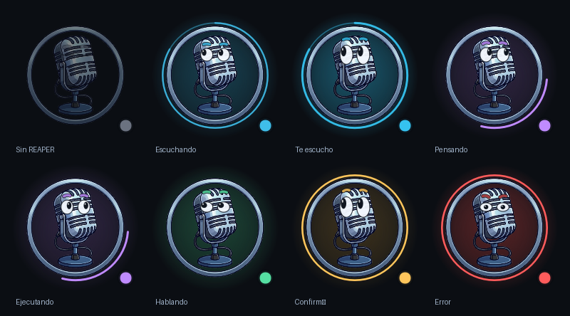

# Visión del producto

## El problema

Grabarse solo es incómodo. Estás con la guitarra colgada, sentado en la batería o
frente al piano, y para hacer cualquier cosa —crear una pista, cargar un plugin,
armar para grabar, subir el monitoreo— tenés que soltar el instrumento, ir al
mouse y romper el estado en el que estabas. Las manos están ocupadas y la
atención también.

El asistente de estudio resuelve eso: alguien que entiende el pedido en voz alta
y lo ejecuta en REAPER sin que te muevas.

## La idea

Un **ícono flotante** en la pantalla, que se arrastra a donde te convenga. Le
hablás y hace. Nada más.

```
        ┌───────────┐
        │   Miky    │   ← un logo chiquito, siempre visible
        └───────────┘
          «Miky, grabá»
                │
                ▼
        REAPER hace cosas
```

No hay ventana de aplicación, ni pestañas, ni un chat ocupando media pantalla.
El ícono tiene tres estados visibles: **encendido y escuchando**, **pensando /
ejecutando**, **sin conexión**. Si está en pantalla, Miky está vivo.

## Cinco decisiones que definen la filosofía

Estas son las que no se negocian; el resto es implementación.

### 1. No es un plugin de REAPER

La interfaz no vive dentro de REAPER. El control se hace con un **script Lua de
fondo** (ReaScript), que no tiene ventana ni menú: habla con la API interna del
DAW y ejecuta comandos. Es el único camino real para llegar a pistas, FX,
transporte y render sin simular mouse ni teclado.

### 2. No es una app con ventana

Todo lo visible es un ícono flotante, un menú contextual y un panel de ajustes
que aparece pegado al ícono. El programa no aparece en la barra de tareas ni en
Alt+Tab, y **no le roba el foco a REAPER**: si lo hiciera, grabar con el teclado
sería un infierno.

El ícono tiene cara: ojos y cejas pintados sobre el micrófono que cambian con el
estado (atento, sorprendido, pensativo, contento, enojado) y parpadean cada
tanto. Además **te sigue con la mirada** cuando el mouse se acerca, y cuando le
hablás se le levantan un poco las cejas y se le agrandan las pupilas: parece que
te está prestando atención. No es decoración: es la forma de saber qué está
pasando sin mirar una pantalla, y de que el asistente se sienta un compañero y no
un botón.



### 3. Solo controla REAPER, y nada más

El asistente no abre programas, no toca archivos ajenos, no inyecta teclado ni
mouse, no ejecuta comandos del sistema. Su superficie de acción es un **catálogo
cerrado de 51 comandos** ([ver catálogo](03-catalogo-comandos.md)). La IA elige
entre esos comandos; no puede escribir código ni inventar operaciones nuevas.

### 4. Oídos y boca locales, cerebro en la nube

El reconocimiento de voz y la síntesis corren en la computadora: la voz nunca
sale a internet y no hace falta una GPU. La interpretación del pedido (lo único
que realmente necesita un modelo grande) va a la nube.

Esa división es la que permite que un i7 de octava generación con 16 GB grabe
sin que el asistente le coma la RAM.

### 5. Cada usuario elige su API

El desarrollo y el uso diario van con **Gemini** (capa gratuita): alcanza para
cientos de órdenes por día. Pero el motor habla con cualquier proveedor
compatible con OpenAI (OpenAI, Groq, OpenRouter, LM Studio, Ollama local):
cambiar de proveedor es cambiar dos líneas de configuración, no reescribir el
asistente.

## Pedidos por objetivo, no por comando

Lo importante no es que Miky entienda «subí la pista 3 a -2 dB», sino que
entienda **qué querés lograr**. Si decís «quiero que la voz suene más brillante»,
no te pide que le digas el comando: busca en su catálogo qué combinación de
acciones produce ese resultado y la ejecuta.

Tres reglas gobiernan esa traducción:

1. **Si hay una solución, la ejecuta.** Prefiere actuar antes que preguntar.
2. **Si hay dos interpretaciones que cambian el resultado, pregunta una sola
   cosa.** Por ejemplo, «quiero que el tema dure menos de tres minutos» → «¿qué
   parte querés recortar?».
3. **Nunca inventa lo que no tiene.** Si el objetivo necesita algo que el
   catálogo todavía no cubre, hace la parte que sí puede y dice qué falta, o
   pide permiso para resolverlo de la forma más parecida.

Esa última regla tiene un guardián en el código: si la IA contesta «ya lo hice»
sin haber llamado a ninguna herramienta, Miky detecta la contradicción, le pide
una segunda respuesta y, si insiste, **no repite la afirmación falsa**: dice que
no lo ejecutó y ofrece la alternativa.

## Para quién

- Música/o que se graba sola y necesita las manos libres.
- Quien produce en un home studio y quiere bajar la fricción de tareas repetitivas
  (nombrar pistas, cargar cadenas, armar para grabar, exportar).
- Quien recién arranca con REAPER y todavía no se acuerda dónde está cada cosa.

## Qué no es

- **No es un DAW nuevo.** Complementa a REAPER, no lo reemplaza.
- **No es un chatbot.** No conversa por conversar: ejecuta.
- **No es un control remoto por mouse virtual.** Usa la API real de REAPER.
- **No promete magia con plugins de terceros.** Puede cargarlos y tocar sus
  parámetros expuestos, pero no conoce la interfaz gráfica de cada uno.

## El nombre

**Miky**, porque es corto, suena rioplatense y el reconocimiento de voz lo
detecta sin confundirlo con el habla normal. Es también la palabra de
activación: se puede cambiar en la configuración (`voice.wake_word`), aunque el
certificador de la beta está ajustado a las variantes de «Miky».

## Criterio de éxito de la beta

Que una persona pueda, sin tocar el mouse:

1. abrir REAPER desde el ícono,
2. decir «Miky, creá una pista de guitarra y armala» y verlo pasar,
3. decir «Miky, grabá», grabar una toma y parar,
4. decir «Miky, renderizá la mezcla» y encontrar el archivo en la carpeta.

Si eso funciona seguido y sin sustos, la beta cumplió.
